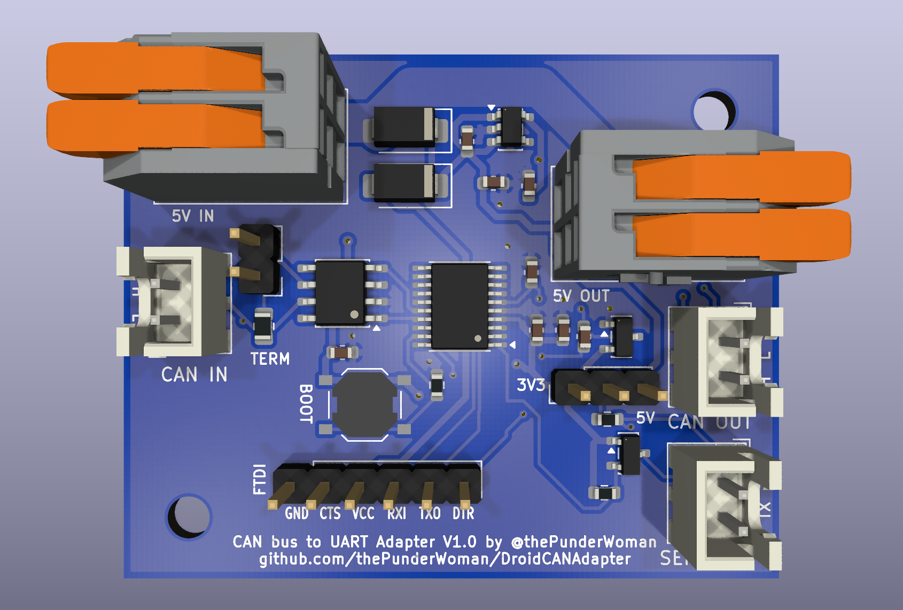

# DroidCANBridge

A very small, inexpensive CAN-to-UART bridge for droid builders: it translates CAN bus frames to a
standard UART and back, so droid components without CAN support can join a CAN network.

- **MCU:** STM32C092 (TSSOP-20), with a built-in CAN FD controller
- **CAN:** CAN FD-capable transceiver; two 2-pin JST-XH connectors (CANL, CANH) for daisy-chaining and a jumper for the
  120 Ω termination resistor
- **UART:** 2-pin JST-XH connector (RX, TX) with a jumper that sets the logic level to 3.3 V or 5 V
- **Power:** 5 V in on a WAGO terminal (reverse-polarity protected), with a WAGO passthrough output
- **Programming:** standard 6-pin FTDI header using the STM32's built-in serial bootloader, with
  DTR auto-reset and a boot button

Status: PCB designed and routed (50 x 40 mm, two layers); not yet ordered. Hardware is in [`PCB/`](PCB/) (see [PCB/README.md](PCB/README.md) for
requirements and design decisions); firmware will live in `src/`.
